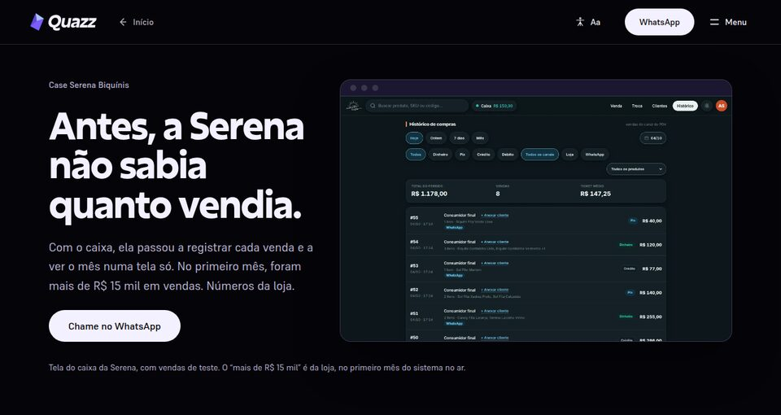
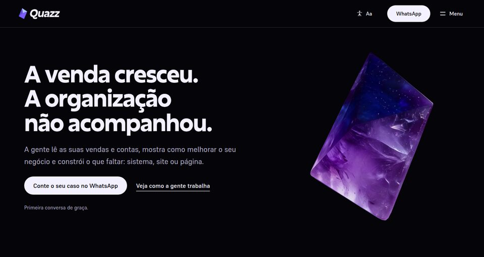
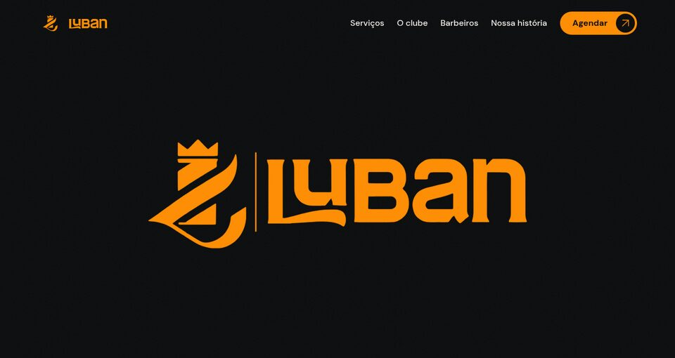
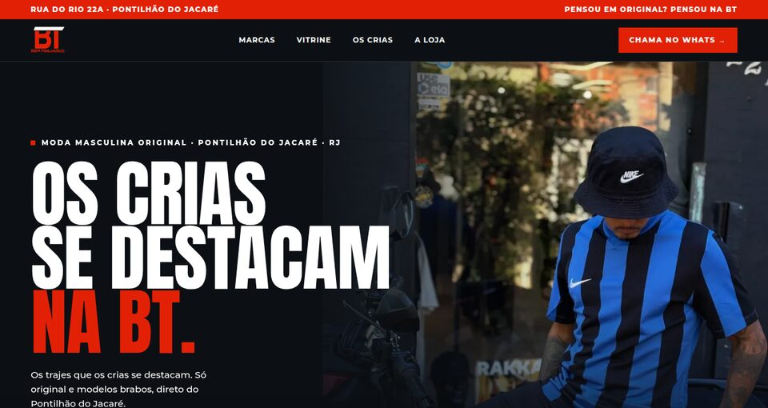
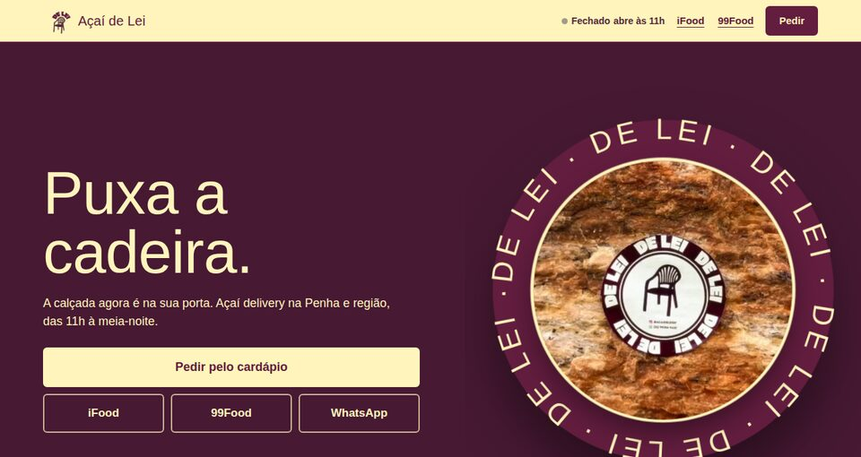
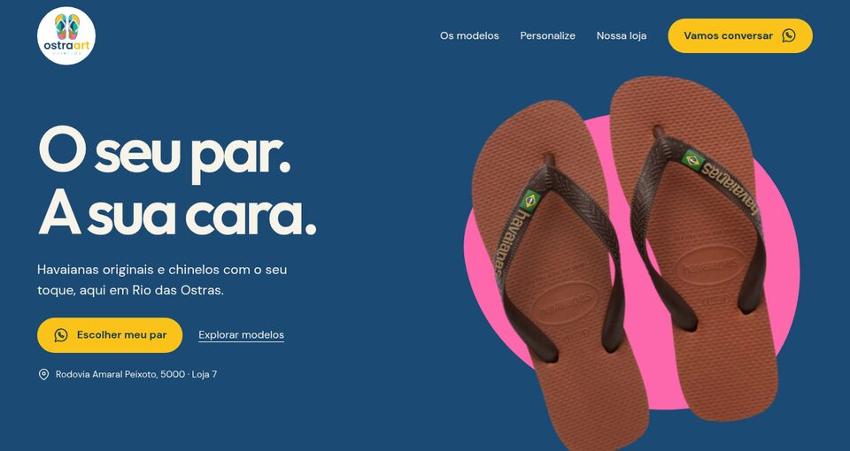
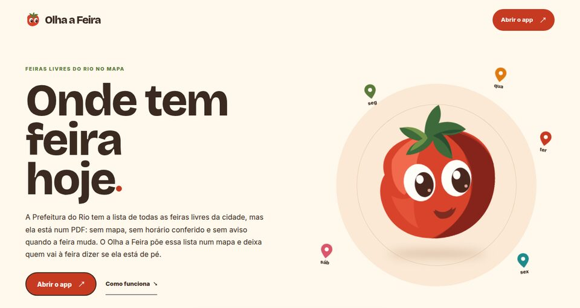

  <h1>Fala, eu sou o JV 👋🏽</h1>
  <h3>Full Stack Developer · E-commerce · Produtos com IA</h3>

  

  

    Transformo ideias em produtos digitais rápidos, úteis e preparados para crescer.
  

  
  
  
  

## Sobre mim

Sou desenvolvedor Full Stack no Rio de Janeiro. Construo interfaces, integrações e sistemas para **e-commerces que não podem parar**, cuidando da jornada completa: da experiência do usuário às regras de negócio, dados e deploy.

- 🛒 Dev web na **Azzas 2154**, no e-commerce VTEX de FARM, Animale, BYNV, Off Premium, Cris Barros, Maria Filó e outras marcas do grupo
- 💜 Tenho a **[Quazz](https://quazz.com.br)**, consultoria de sistemas e sites para pequenos negócios, que toco em parceria
- 🍅 Criei o **[Olha a Feira](https://feiras-cariocas.vercel.app)**, o mapa colaborativo das feiras livres do Rio
- 🎓 Ciência da Computação na [PUC-Rio](https://www.puc-rio.br/)
- 🤖 Explorando IA aplicada, automações e novas formas de criar produtos
- 🎨 Apaixonado por unir engenharia, produto e uma interface bem pensada

 

  <a href="https://quazz.com.br">
    <picture>
      <source media="(prefers-color-scheme: dark)" srcset="assets/quazz-logo-escuro.svg" />
      
    </picture>
  </a>
  
<strong>Sistema, consultoria e site para pequenos negócios.</strong> A gente lê as vendas e as contas, mostra o que melhorar e constrói o que falta.

<table>
  <tr>
    <td width="50%" valign="top">
      
      
<strong>Sistema da Serena Biquínis</strong> Caixa que vende até sem internet e marca se a venda veio do balcão ou do WhatsApp, mais um painel financeiro do mês. No ar desde 19/09/2026: a loja vendeu mais de R$ 15 mil no primeiro mês.

    </td>
    <td width="50%" valign="top">
      
      
<strong>Ametista e Quazz CMS</strong> A Ametista é o agente de IA da Quazz: lê vendas, contas e o que a marca publica, e uma pessoa da equipe confere. O CMS deixa o cliente editar a própria página sem chamar ninguém.

    </td>
  </tr>
</table>

**Sites de clientes no ar**

<table>
  <tr>
    <td width="50%" valign="top">
      
      
<a href="https://luban.quazz.com.br"><strong>LUBAN Barbearia</strong></a> · barbearia e clube de assinatura na Vila da Penha

    </td>
    <td width="50%" valign="top">
      
      
<a href="https://bemtrajados-lp.vercel.app"><strong>Bem Trajados</strong></a> · moda masculina no Jacaré

    </td>
  </tr>
  <tr>
    <td width="50%" valign="top">
      
      
<a href="https://delei-lp.vercel.app"><strong>Açaí de Lei</strong></a> · açaí delivery na Penha

    </td>
    <td width="50%" valign="top">
      
      
<a href="https://ostraart.chinelos.quazz.com.br"><strong>Ostra Art Chinelos</strong></a> · chinelos personalizados em Rio das Ostras

    </td>
  </tr>
</table>

Também: [página de links da Serena Biquínis](https://links.serenabiquinis.com.br).

`Next.js` `React` `Node.js` `Medusa` `Supabase` `Vercel`

## 🍅 Olha a Feira

A Prefeitura do Rio tem a lista de todas as feiras livres da cidade, mas ela está num PDF: sem mapa, sem horário conferido e sem aviso quando a feira muda. O **Olha a Feira** põe essa lista num mapa e deixa quem vai à feira dizer se ela está de pé.

- 🗺️ Cada feira aparece no mapa como um trecho de rua, não como um ponto
- ✅ **Tem feira aqui agora?** Quem está perto, dentro do horário, confirma com Sim ou Não e pode mandar foto
- 📄 Cada dado mostra de onde veio: lista da Prefeitura, Google Maps ou confirmação de quem esteve lá
- 🔒 O app não guarda coordenada nem IP junto da confirmação

`React 19` `Vite` `Tailwind CSS 4` `MapLibre GL` `Supabase` `Cloudflare Turnstile`

**[Abrir o app](https://feiras-cariocas.vercel.app)** · **[Ver o código](https://github.com/jvsfrancisco/feiras-cariocas)**

## Outros projetos

| Projeto | O que é | Stack |
| :-- | :-- | :-- |
| [**Portfólio**](https://joao.quazz.com.br) · [código](https://github.com/jvsfrancisco/portifolio) | Meu portfólio com visual de colagem: papéis recortados, fitas e etiquetas | TanStack Start, React 19, CSS |
| [**Connect.AI**](https://conectai.vercel.app/) · [código](https://github.com/jvsfrancisco/conect.ai) | Plataforma que usa IA para aproximar candidatos e oportunidades | Next.js, TypeScript, OpenAI |

## Stack

### Front-end

### Back-end, dados & IA

### E-commerce, cloud & qualidade

## Meus commits viram jogo 🕹️

  <picture>
    <source media="(prefers-color-scheme: dark)" srcset="https://raw.githubusercontent.com/jvsfrancisco/jvsfrancisco/output/pacman-contribution-graph-dark.svg" />
    <source media="(prefers-color-scheme: light)" srcset="https://raw.githubusercontent.com/jvsfrancisco/jvsfrancisco/output/pacman-contribution-graph.svg" />
    
  </picture>

    

  <picture>
    <source media="(prefers-color-scheme: dark)" srcset="https://raw.githubusercontent.com/jvsfrancisco/jvsfrancisco/output/github-contribution-grid-snake-dark.svg" />
    <source media="(prefers-color-scheme: light)" srcset="https://raw.githubusercontent.com/jvsfrancisco/jvsfrancisco/output/github-contribution-grid-snake.svg" />
    
  </picture>

---

  <strong>Aberto a boas ideias, projetos desafiadores e conversas sobre tecnologia.</strong>

